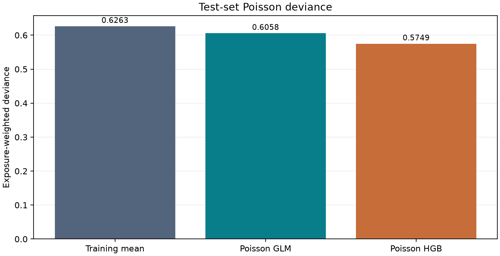

# MotorClaimLab

**자동차보험 청구 빈도를 분석하고 모델의 오차와 한계를 설명하는 재현 가능한 연구 프로젝트.**

보험 가입 기간이 다른 계약을 공정하게 비교하면서, 단순 평균·포아송 회귀·부스팅 모델의 예측과 집단별 과소·과대예측을 평가합니다. 채용 포트폴리오를 위한 개인 프로젝트이며 KB손해보험 또는 다른 보험사의 의뢰·검증·운영 시스템이 아닙니다.

현재 단계: **전체 678,013행의 동결 실험과 renderer 2.0**. 로컬 전체 **104개 테스트**와 [renderer의 실제 3개 CI 작업](https://github.com/KIMJINWOO0548/MotorClaimLab/actions/runs/41223891243)이 통과했습니다. 검증 분할에서 선택한 부스팅 모델의 테스트 포아송 편차가 평균 기준 모델 대비 **8.21% 낮았습니다**. 과거 프랑스 자료의 고정 분할 결과이며 업무 효과를 주장하지 않습니다.

새 [presentation v2 HTML](docs/evidence/presentation-v2/report.html)은 세 모델 비교표, 데이터·코드·seed·split 출처 접기, 0 기준선이 있는 쌍체 구간을 제공합니다. MLflow·Evidently·scikit-learn에서 채택한 패턴과 제외한 부분은 [실제 적용 기록](docs/REFERENCE_ADOPTION.md)에 있습니다. 새 UI는 재학습 없이 같은 결과 JSON에서 파생했으며 [별도 renderer·입력·출력 해시](docs/evidence/presentation-v2/presentation.json)로 추적합니다. 원래 10개 실험 증거와 예상 해시는 보존했습니다.

| 모델 | 검증 포아송 편차 | 테스트 포아송 편차 | 테스트 관측 / 예측 청구 |
| --- | ---: | ---: | ---: |
| 학습 평균 기준 | 0.627851 | 0.626294 | 1.002149 |
| 포아송 회귀 | 0.606750 | 0.605803 | 1.002349 |
| 포아송 부스팅 | **0.575899** | **0.574883** | 1.005993 |

선택 모델 − 기준 모델의 테스트 편차 차이 95% 쌍체 부트스트랩 구간은 **[-0.05512, -0.04785]**입니다. 고정 분할과 이미 적합한 모델에 조건부이며 재학습·미래 시점 불확실성을 포함하지 않습니다.



전체 평균 오차가 줄어도 예측 상위 10% 구간에는 과소예측이 남았습니다. [결과와 해석](docs/RESULTS.md), [원본 집계 JSON](docs/evidence/benchmark/results.json), [오프라인 HTML 보고서](docs/evidence/benchmark/report.html), [실제 CI](https://github.com/KIMJINWOO0548/MotorClaimLab/actions/runs/41218810116)를 확인하세요.

- 설계: [docs/DESIGN.md](docs/DESIGN.md)
- 구현 계획: [docs/superpowers/plans/2026-11-01-motorclaimlab.md](docs/superpowers/plans/2026-11-01-motorclaimlab.md)
- 데이터 출처·이용조건: [docs/DATA_SOURCE.md](docs/DATA_SOURCE.md)
- 실제 검증 상태: [docs/STATUS.md](docs/STATUS.md)
- 검증 명령·실패와 복구: [docs/VALIDATION.md](docs/VALIDATION.md)

Python 3.12를 기본 실행 환경으로 사용하며 CI에서 Linux 3.12·3.13, Windows 3.12를 실제 실행했습니다. 데이터 원본·계약별 예측·가상환경은 공개 저장소에서 제외합니다. 공개 자료는 집계 결과와 이를 재현하는 코드로 제한합니다.

## 실행

Windows PowerShell, 저장소 루트 기준입니다. 별도 계정·API 키·유료 서비스가 필요하지 않습니다.

```powershell
py -3.12 -m venv .venv
.\.venv\Scripts\python.exe -m pip install --require-hashes -r requirements-dev.lock
.\.venv\Scripts\python.exe -m pip install --no-deps --no-build-isolation -e .
.\.venv\Scripts\python.exe -m motorclaimlab fetch --output data/raw
.\.venv\Scripts\python.exe -m motorclaimlab run --input data/raw/freMTPL2freq.arff --output reports/runs/my-study
```

모델 실행 없이 저장된 결과의 새 표현만 만들려면 새 출력 경로를 사용합니다.

```powershell
.\.venv\Scripts\python.exe -m motorclaimlab render --results docs/evidence/benchmark/results.json --selection docs/evidence/benchmark/selection.json --output reports/runs/my-presentation
```

`fetch`는 기존 원본을, `run`은 기존 출력 디렉터리를 덮어쓰지 않습니다. 재실행에는 새 출력 경로를 지정하세요. 다운로드는 체크섬을 검증합니다. 모든 모델과 전처리는 학습 자료에만 적합하고 검증 자료로 모델을 선택한 뒤 테스트 자료를 평가합니다.

작은 탐색 실행은 `run`에 `--max-rows 50000 --max-iter 30 --bootstrap-draws 50`을 추가할 수 있습니다. 표본·설정 변경 사실이 결과에 기록되며 전체 고정 프로토콜 실행과 구분됩니다.

새 실행 폴더에는 `results.json`, `report.html`, `report.md`, SVG·PNG 차트, 설정 및 선택 기록이 생성됩니다. `predictions.csv`와 `split-membership.csv`는 재현 확인용 로컬 파일이며 공개하지 않습니다.

## 확인된 데이터 범위

OpenML 원본 **678,013행·12열**, 청구 **36,102건**, 노출 합계 **358,499.445년**을 확인했습니다. 1년 초과 노출 1,224행과 4건 초과 청구 9행을 임의로 자르지 않고 보존합니다. SHA-256은 `a45363e056e2ea56408b38eeb9d4d04d7f6c6982eb7a14ed5e807c7c71807cdd`입니다.

고정 seed `20261101`의 정책 ID 해시 분할은 학습 406,061행 / 검증 136,283행 / 테스트 135,669행입니다. 관측 날짜를 대체하는 분할이 아닙니다.

## 검증 명령

```powershell
.\.venv\Scripts\python.exe -m pytest -q
.\.venv\Scripts\python.exe -m ruff check src tests scripts
.\.venv\Scripts\python.exe -m ruff format --check src tests scripts
.\.venv\Scripts\python.exe -m build --no-isolation
.\.venv\Scripts\python.exe scripts/check_distribution.py
.\.venv\Scripts\python.exe scripts/check_evidence.py
.\.venv\Scripts\python.exe scripts/check_presentation.py
```

자동 테스트는 직접 작성한 합성 자료로 실행하며 네트워크를 사용하지 않습니다. 실제 공개 자료 실험과 별도입니다. 브라우저 접근은 URL 정책으로 차단되어 실제 브라우저 접근성 검사는 미실행입니다. 다른 서버나 브라우저 경로로 우회하지 않았습니다.

`check_evidence.py`는 Git 체크아웃에서 실행하며 실제 Git blob과 공개 증거의 SHA-256을 대조합니다. 이 검사는 바이트 일치만 확인하며 자료 권리·저자·과학적 타당성을 인증하지 않습니다.

`check_presentation.py`는 새 표현의 동결 입력·renderer 소스·산출물을 별도로 대조합니다. [표현 개선 설계](docs/PRESENTATION_V2.md)는 기존 실험의 모델 선택·평가와 구분됩니다.

## 연구 경계

자료는 과거 프랑스 자동차보험 벤치마크입니다. 현재 한국 보험시장의 성능·수익·업무 절감이나 미래 시점 일반화는 입증하지 않습니다. 예측값으로 보험료, 인수 여부 또는 보험금 지급을 결정하지 않습니다.

Original project code is licensed under MIT. Dataset and referenced documentation have separate terms; see [DATA_SOURCE](docs/DATA_SOURCE.md).
