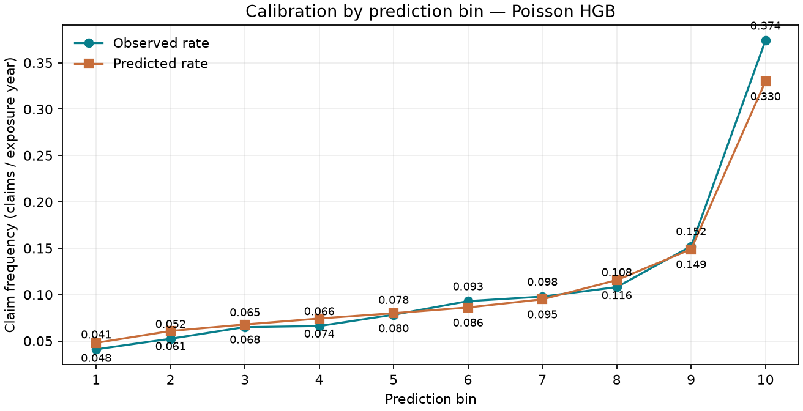

# 전체 자료 실험 결과

2026-11-01 KST. 소스 커밋 `751e6f760489ead0f88f63cd68fb52abe19b4d4d`, 패키지 코드 SHA-256 `d825b99db2e819d31df1e19dc6915d1cb1f95a1c4c8503de8ec36907da7d4e7d`의 실행입니다. [원래 집계 결과](evidence/benchmark/results.json)와 [실행 설정·모델 선택](evidence/benchmark/selection.json)을 보존합니다.

## 질문과 실험 조건

보험 가입 기간이 다른 관측에서 청구 빈도를 어떻게 비교하며, 모델의 전체 오차 개선과 집단별 오차가 함께 나타나는지 확인했습니다. OpenML 41214 v1 전체 678,013행을 사용했습니다. 원본 MD5와 SHA-256을 확인했고 유효한 극단값을 임의로 자르지 않았습니다.

seed 20261101의 ID 해시 분할은 학습 406,061행, 검증 136,283행, 테스트 135,669행입니다. 전처리와 모델은 학습 분할에만 적합했습니다. 검증 포아송 편차로 모델을 선택하고 `selection.json`을 기록한 후 테스트 예측과 평가를 실행했습니다. 실제 결과를 보고 seed·모델 설정을 바꾸지 않았습니다.

목표는 `ClaimNb / Exposure`, 적합·평가 가중치는 `Exposure`입니다. 예측 청구 건수는 계약별 예측 빈도와 관측 기간의 곱을 합산했습니다. ID, 청구 건수, 가입 기간은 설명변수에서 제외했습니다. 고정 모델·설정은 [설계서](DESIGN.md)에 있습니다.

## 관찰된 결과

| 모델 | 검증 편차 | 테스트 편차 | 테스트 가중 MAE | 총 예측 청구 |
| --- | ---: | ---: | ---: | ---: |
| 학습 평균 | 0.627851 | 0.626294 | 0.188820 | 7,204.52 |
| 포아송 회귀 | 0.606750 | 0.605803 | 0.186772 | 7,203.08 |
| 포아송 부스팅 | **0.575899** | **0.574883** | **0.182861** | 7,176.99 |

테스트의 관측 청구는 7,220건, 노출 합계는 71,734.834년입니다. 선택 모델은 검증에서 가장 낮은 편차를 보인 부스팅입니다. 테스트 편차의 기준 모델 대비 상대 감소는 **8.20876%**였습니다. 이는 업무 절감률이나 수익 개선률이 아닙니다.

선택 모델 − 기준 모델의 테스트 편차 차이는 **-0.05141097**, 정책 단위 쌍체 부트스트랩 200회 / seed 20261101의 95% 백분위 구간은 **[-0.05511943, -0.04784530]**였습니다. 같은 관측 인덱스로 두 모델을 비교했습니다. 이 구간은 고정된 분할과 적합에 조건부이며 모델 재학습·자료 수집 과정·미래 시점의 불확실성을 나타내지 않습니다.

## 전체 점수로 가려지는 오류

- 예측 상위 10% 구간: 13,566행, 노출 4,895.669년, 관측 1,831건 / 예측 1,615.58건. 관측 청구가 예측보다 **13.33% 많았습니다**.
- 25세 미만 구간: 관측 497건 / 예측 446.81건. 관측/예측 비율은 **1.11233**이었습니다.
- Area D 구간: 관측/예측 비율 **0.92004**로 전체 합계와 다른 방향의 오차가 나타났습니다.

따라서 평균 편차 개선만으로 모든 구간의 보정이 충분하다고 판단할 수 없습니다. 실제 도입을 검토한다면 해당 집단의 자료·변수 정의·오류 사례와 새로운 독립 자료의 재현성을 추가로 점검해야 합니다. 이 테스트 자료로 새 임계값이나 후속 모델을 최적화하지 않았습니다. 위 분석은 미리 정한 구간의 기술적 오류 분석이며 인과관계나 차별 여부를 인증하지 않습니다.

## 재현과 산출물

- [검증·테스트 지표, 보정 구간, 집단별 오차와 환경](evidence/benchmark/results.json)
- [독립 실행 HTML](evidence/benchmark/report.html), [Markdown 보고서](evidence/benchmark/report.md)
- [검증 분할에 근거한 선택 기록](evidence/benchmark/selection.json)
- [원본 감사](evidence/source-audit.json), [검증 기록](VALIDATION.md)

Windows / Python 3.12.10 / 2개 수치 연산 스레드에서 모델 적합 구간은 18.42초였습니다. `timing.total_seconds` 133.71초는 코드가 측정한 보고서 렌더링 전 분석 구간이며 CLI 전체 벽시계 시간이나 통제된 성능 벤치마크가 아닙니다.

원본과 개별 예측·분할 ID는 Git에 포함하지 않았습니다. 로컬 원 실행은 `reports/runs/20261031T161041Z-full-beaf67b5/study/`이며 공개 증거는 집계 산출물만 선별했습니다. 같은 소스·설정의 재현 절차는 [README](../README.md)에 있습니다.

## 남은 경계

과거 프랑스 자료이며 관측 날짜가 없어 시간 순서 검증을 하지 못했습니다. 현재 한국·KB손해보험 적용성, 원 보험사의 권리·수집 경위, 보험계리 전문가 검수, 실제 사용자 업무 효과는 입증하지 않았습니다. OpenML의 CC0 표기와 원 자료 권리의 독립 검증은 구분합니다. 내부 AI 보조 검토는 외부 인간 검수가 아닙니다.

브라우저는 파일 URL 정책에 의해 차단되어 실제 브라우저 레이아웃·접근성 검증은 미실행입니다. 정책을 우회하지 않고 CLI, HTML/SVG 구조, 실제 Matplotlib PNG 차트만 검사했습니다. 보험료 산정·인수·보험금 지급 등 운영 결정에 사용하는 기능은 없습니다.
